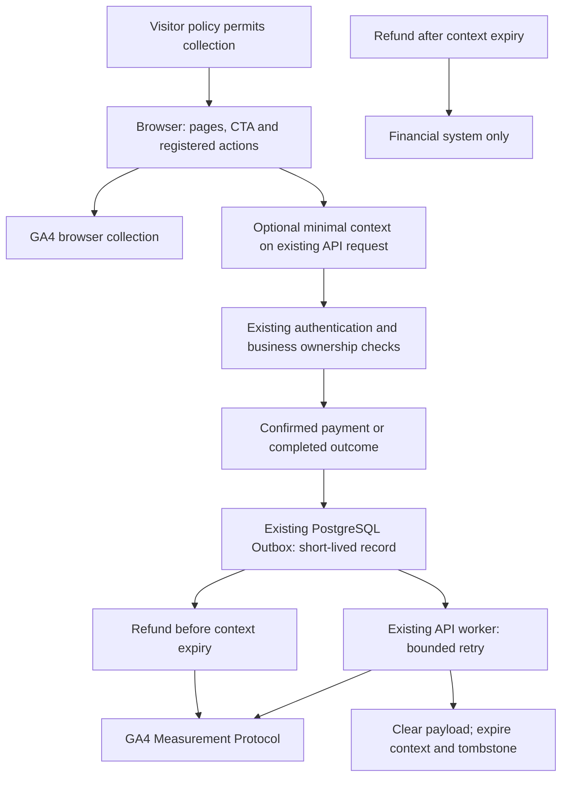

# Analytics acceptance and GA4 setup — AN04

Status: AN04 software acceptance is separated from AN05 post-merge Dev acceptance by
explicit owner instruction. Local checks and real browser-property receipt are recorded
in the Phase12 log; actual server/domain acceptance remains pending. Production is off.
Confirmed Development target (owner supplied and verified in the Google Analytics UI):

- Stream: **Mushroom - Dev Web**; Stream ID `16282576410`.
- Web URL: `https://dev.drshirmardi.com`; Measurement ID **`G-KXRZ89EFTY`**.
- Enhanced Measurement switch: OFF (observed, not changed).
- API secret file: not yet prepared, per owner. Server delivery remains disabled.

The explicit public Dev acceptance profile is
[`deploy/vps/analytics.dev.env.example`](../deploy/vps/analytics.dev.env.example).
Merge it only into the existing Dev runtime configuration; it is not loaded automatically
and is never a Production default. Its browser consent opt-in covers controlled Dev testing;
visitor collection/withdrawal policy remains a separate release gate.

The current installer provides `sudo mushroom setup-analytics --environment dev` (also
available in its panel). Choose browser/server/disabled, enter the public Measurement ID,
select DebugView and enter the private secret through hidden input when server mode is
selected. It preserves unrelated settings and existing credentials unless replacement is
explicitly selected. After updating the installer from the approved bundle and configuring
the target, rerun the shared Dev synchronization workflow to apply runtime changes;
restart alone does not recreate the Compose environment. See installation/README.md.



## 1. Record the target without exposing secrets

- [x] Confirm the Development Web Stream/Measurement ID above. Public Dev runtime currently
  points to dev-api.drshirmardi.com and dev-app.drshirmardi.com; the deployed site did not
  yet expose analytics settings when inspected. Use the same ID on web, app and API.
- [ ] Place the stream's Measurement Protocol API secret in a private file on the API host.
  Supply its path through the existing secret-file configuration; never send its value
  in chat, browser config, screenshots, logs or Git. Record only “present/readable”.
- [ ] Confirm the visitor collection and withdrawal policy. Runtime `granted` is a
  technical gate, not a consent banner. Current local opt-out stops future browser sends
  but does not revoke already captured server context. Resolve this before activation.

## 2. Configure the stream

- [x] In Admin → Data streams → Web, Enhanced Measurement is disabled. Disable automatic page
  and history-change tracking because the application's route observer owns page views.
  Keep automatic form/search/other interaction collection off until separately reviewed.
- [ ] In Configure tag settings → Configure your domains, verify the real web/app domains
  use the same stream. Check subdomain cookie-domain consistency and unwanted self-referrals.
  The application's CTA/campaign handoff alone does not certify Google's native identity.
- [ ] Review filters so the controlled acceptance visit can be inspected and is not
  accidentally discarded as internal/developer traffic. Do not change filters silently.
- [ ] Review Google Signals/ad-personalization settings against the collection policy.

## 3. Prepare useful reports

Create only the definitions needed by the first reports, using event scope:

| Report meaning | Parameter / definition |
| --- | --- |
| Site surface and logical page | `surface`, `page_path` |
| CTA and section | `action_id`, `section_id`, `entry_cta` |
| Registered operation and outcome | `operation`, `outcome`, `status_code` |
| Duration | `duration_ms` numeric metric |
| Exact settled rial amount within safe numeric range | `amount_rial` numeric metric, Standard unit |
| Campaign | Built-in acquisition reports plus inspected `source`, `medium`, `campaign` fields |

Do not register client/session/order/transaction identifiers as custom dimensions.
The amount metric is in rial; divide by ten for a toman presentation. Standard GA4
currency revenue is not populated. Very large amounts use exact `amount_rial_text`
and cannot be summed by the numeric metric. Paid non-commerce services currently count
`service_paid` without amounts. Review which of `purchase`, `sign_up`,
`assessment_completed`, `booking_confirmed`, `service_paid` should be key events.
Marking key events is an operator decision, not automatically performed by this code.

## 4. Controlled live acceptance

`PUBLIC_ANALYTICS_DEBUG=true` adds `debug_mode: true` to browser and server events through
the existing single browser loader and transport. It defaults to false. To exit debug
mode, set the flag to false and reload/restart the relevant runtime; code omits the
parameter entirely, because sending `debug_mode: false` does not disable Google's debug mode.
Debug mode does not bypass consent or enable the disabled server transport.

The November6 controlled test ran the current production-built web app locally with the
real Dev stream and real Google script. The actual Google UI showed page_view,
cta_impression and cta_click in DebugView and one active user/event counts in Realtime.
This is receipt from the local acceptance build, not a deployed Dev-domain sign-off.
Live testing detected an automatic raw-URL page view in addition to the manual one.
The shared loader now sets safe global defaults before any destination initializes.
Post-fix actual Google network inspection confirmed one loader, one manual page_view,
one transmitted page_view with title Mushroom and logical /landing, and no query string;
the separate batched request contained only two CTA impressions. No extra Google tag or
GTM container was added. No real login, bank transaction or medical information was sent.

- [ ] With the accepted policy and test environment configured, visit the real landing
  page with a harmless campaign slug and click an explicit CTA to the app. Verify one
  page view per actual route, CTA/campaign continuity and no raw query, account ID or text.
- [ ] Verify the property-scoped GA client/session IDs on both origins with the real SDK.
  Do not copy identifiers into public evidence. Missing/stale IDs intentionally skip
  server conversions; an open page does not continuously refresh its initial snapshot.
- [ ] Validate a sanitized real-shape Measurement Protocol payload with the official
  `/debug/mp/collect` endpoint using `ENFORCE_RECOMMENDATIONS`. Record validation codes
  only. This endpoint does not create report events or verify the API secret.
- [ ] Perform an authorized test-environment payment through the normal UI. Verify the
  financial result, one local purchase record and bounded worker submission. Inspect
  actual receipt in the target GA4 property; HTTP2xx and an empty validator result are
  insufficient proof. No production financial transaction is authorized by this checklist.
- [ ] Verify the custom rial metric and actual transaction/item data. Server conversions
  have no invented engagement duration; absence in Realtime alone does not establish loss.
  Use appropriate event/report inspection and allow the property's processing delay.
- [ ] Verify a same-window completed refund; after context expiry verify only the
  financial result. Do not retain attribution longer to make a late refund appear.
- [ ] Repeat opt-out and blocked-script cases: product/payment still works, no conversion
  without valid context, no secret or private query in analytics or request logs.
- [ ] Record environment, date, reviewed event names, receipt result and operator sign-off
  without identifiers, credentials, patient information or payload dumps.

The local browser test uses the actual production app, real API/PostgreSQL, actual worker
serialization and loopback HTTP collection. It substitutes only the synthetic session
bootstrap and Google's getter callbacks/outbound destination. It covers mobile390 and
desktop1440, payment confirmation, receipt reload, consent denied and blocked SDK. It does
not certify real OTP/login, real bank processing, native Google identity or property receipt.

## 5. Stop collection and preserve financial behavior

Set browser `PUBLIC_ANALYTICS_CONSENT=denied` and API `ANALYTICS_SERVER_ENABLED=false`,
then apply those runtime changes using the normal environment procedure. Reload clients
to pick up changed runtime config. The disabled worker drops due deliveries and continues
bounded cleanup; context expires under the existing short retention. This is not immediate
revocation of Google's historical data or all already captured server context.

Sources checked 2026-11-06:

- [Validate events](https://developers.google.com/analytics/devguides/collection/protocol/ga4/validating-events)
- [Cross-domain measurement](https://support.google.com/analytics/answer/10071811)
- [Analytics currency reference](https://support.google.com/analytics/answer/9796179)
- [Measurement Protocol reference](https://developers.google.com/analytics/devguides/collection/protocol/ga4/reference)
- [DebugView and removing debug_mode](https://support.google.com/analytics/answer/7201382)

Repeatable local command (from the repository root after building apps/app): use a
dedicated disposable, seeded localhost `/wallet_test` database, set
`WALLET_BILLING_TEST_ISOLATED=1`, `ANALYTICS_BROWSER_TEST=1`, include
`http://127.0.0.1:3311` in `APP_ORIGINS`, and supply the existing synthetic test signing/
encryption environment. Then run:

```text
corepack pnpm --filter @sabz-zendegi/api exec vitest run test/wallet-billing.integration.spec.ts --no-file-parallelism
```

The test launcher owns port3311 temporarily; all fixture financial records remain solely
in that disposable database. It restores ignored runtime build output and stops its own
frontend. Remove the dedicated database/container after verification.
